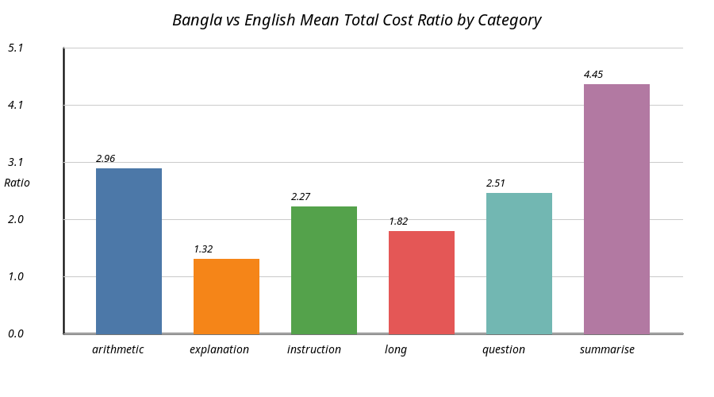

# Assignment 2 Report — English vs Bangla Token Cost

**Model:** `qwen2.5:3b` (Ollama, `http://localhost:11434`, local)  
**Dataset:** `dataset.tsv` — 50 aligned English/Bangla pairs (categories: `question`, `instruction`, `explanation`, `arithmetic`, `summarise`, `long`), same meaning intended per pair.  
**Settings (identical for both languages):** temperature `0`, seed `0`, `num_predict` `256`, same fixed system prompt (`"You are a helpful assistant."`), `keep_alive: 0` on every call, no "answer in the same language" instruction.  
**Cost model (notional):** input $0.15 / 1M tokens, output $0.60 / 1M tokens.

## Method
- **Counting (`counter.py`):** injectable-backend client wrapper; reads `prompt_eval_count` (input) and `eval_count` (output), latency, `done_reason`, output text. `keep_alive=0` sent every call. Baseline measured once with prompt `"hi"` (same system prompt); cache check runs `"hi"` twice and confirms identical `prompt_eval_count` (flags missing/mismatch).
- **Run (`runner.py`):** 50 English + 50 Bangla prompts with identical settings, resumable `results.csv` (one row per call).
- **Analysis (`analyze.py`):** per-pair ratios, totals, summary statistics, bootstrap 95% CI (10,000 resamples, fixed seed) of per-pair total cost ratio, latency by language, per-category ratios, largest-gap categories, and chart.

**Baseline & cache (real, `baseline_and_cache.json`):** baseline (`"hi"`) `input_tokens=20`, `output_tokens=10`, `done_reason=stop`; cache check **OK** (`prompt_eval_count` 20 and 20).

## Results

### Totals and aggregate ratios
| Measure | English | Bangla | Bangla/English ratio |
|---|---:|---:|---:|
| Input tokens (total) | 2140 | 7216 | 3.3720 |
| Output tokens (total) | 6353 | 9644 | 1.5180 |
| Total cost, USD (notional) | 0.00413280 | 0.00686880 | 1.6620 |

- **Input cost ratio (total, by input tokens):** 3.3720
- **Total cost ratio (total):** 1.6620

### Per-pair ratio statistics (Bangla / English)
| Ratio | Mean | Median | Min | Max | Bootstrap 95% CI (mean) |
|---|---:|---:|---:|---:|---:|
| Input ratio | 2.9677 | 2.7639 | 1.1786 | 5.3562 | — |
| Output ratio | 2.7175 | 1.5436 | 0.4575 | 17.3846 | — |
| Total cost ratio | 2.5253 | 1.7090 | 0.5270 | 11.5488 | [2.0454, 3.0811] |

### Latency by language (seconds)
| Language | Mean | Median | Min | Max |
|---|---:|---:|---:|---:|
| English | 21.7236 | 19.0379 | 3.6363 | 50.1840 |
| Bangla | 37.1939 | 33.0696 | 7.4664 | 67.1201 |

### Per-category mean ratios (Bangla / English)
| Category | n | Mean input ratio | Mean output ratio | Mean total cost ratio |
|---|---:|---:|---:|---:|
| arithmetic | 8 | 1.6989 | 3.9685 | 2.9564 |
| explanation | 8 | 3.1082 | 1.2473 | 1.3242 |
| instruction | 8 | 2.4162 | 2.3571 | 2.2659 |
| long | 10 | 4.6165 | 1.5390 | 1.8218 |
| question | 8 | 1.8747 | 2.6803 | 2.5084 |
| summarise | 8 | 3.6795 | 4.8076 | 4.4513 |

### Largest-gap categories (by highest per-pair total cost ratio observed)
| Category | Pair id | Total cost ratio |
|---|---:|---:|
| arithmetic | 32 | 11.5488 |
| instruction | 14 | 6.1623 |
| summarise | 38 | 5.7107 |

### Chart

*Figure: Mean total cost ratio (Bangla/English) per category. Dashed reference at 1.0 would indicate parity; all categories are above 1.0 on average here.*

## Conclusions
- **Bangla is more token-expensive than English in this run.** Aggregate totals show Bangla used ~3.37× input tokens and ~1.52× output tokens, for ~1.66× total notional cost overall. Per-pair total cost ratios average ~2.53 (median ~1.71) with a bootstrap 95% CI of [2.05, 3.08], indicating the higher cost is consistent across pairs rather than driven by a single outlier alone.
- **Input/tokenization overhead dominates.** Bangla prompts consistently required more input tokens (every category mean input ratio > 1), with the largest mean input inflation in `long` (4.62×) and `summarise` (3.68×). This aligns with script/tokenization effects for Bangla in the model/tokenizer.
- **Output behavior varies by category.** `summarise` and `arithmetic` show high mean output and total cost ratios (summarise mean total 4.45×), while `explanation` is closest to parity in total cost (1.32× mean) despite higher input tokens, partly because English outputs were relatively longer in that category on average.
- **Latency is higher for Bangla.** Mean latency was ~37.2s (Bangla) vs ~21.7s (English), consistent with higher token counts/processing.
- **Variability is substantial.** Per-pair total cost ratios range from 0.53× to 11.55× (e.g. pair 32, arithmetic, had very short English vs much longer Bangla output), so category/aggregate trends are more informative than any single pair.

**Reproducibility notes:** results are from real `qwen2.5:3b` runs recorded in `results.csv`; `comparison.csv`/chart derived via `analyze.py` (bootstrap seed fixed). Reruns may vary slightly with runtime/model state despite fixed generation settings, but methodology (`keep_alive=0`, identical settings/prompts) is held constant.
